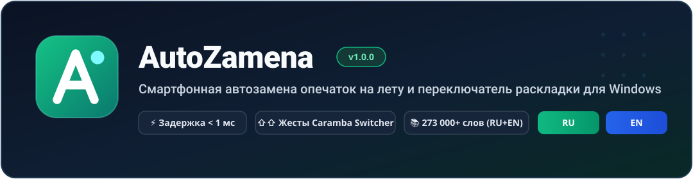
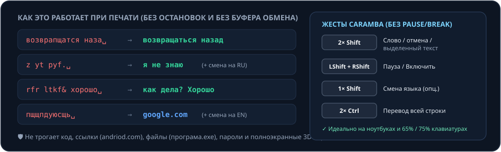

<div align="center">



<br/>

[](https://github.com/ToshakGulina/windows-autozamena/actions/workflows/build-windows.yml)
[](https://github.com/ToshakGulina/windows-autozamena/releases/latest)
[-0078D4?logo=windows)](https://github.com/ToshakGulina/windows-autozamena/releases/latest)
[](https://dotnet.microsoft.com/)
[](SECURITY.md)
[](LICENSE)

**Печатайте на ПК так же быстро и расслабленно, как на смартфоне.**  
Мгновенное исправление опечаток (`< 1 мс`) по физическому расстоянию клавиш и контексту + умное переключение раскладки **`RU ↔ EN`** с жестами **Caramba Switcher** — без клавиши `Pause/Break`, без сетевых запросов и без порчи буфера обмена.

[**📦 Скачать установщик (.exe)**](https://github.com/ToshakGulina/windows-autozamena/releases/latest/download/AutoZamena-Setup-win-x64.exe) · [**Все пакеты в Releases**](https://github.com/ToshakGulina/windows-autozamena/releases/latest) · [**Безопасность и приватность**](SECURITY.md) · [**История изменений**](CHANGELOG.md)

</div>

---

## 📥 Скачать и установить (Windows 10 / 11 x64)

Готовые установщики и портативные сборки лежат прямо в разделе [**GitHub Releases**](https://github.com/ToshakGulina/windows-autozamena/releases/latest):

| Пакет | Прямая ссылка | Описание |
|---|---|---|
| 🏆 **Полный установщик** *(рекомендуется)* | [**`AutoZamena-Setup-win-x64.exe`**](https://github.com/ToshakGulina/windows-autozamena/releases/latest/download/AutoZamena-Setup-win-x64.exe) | Работает на любой чистой Windows 10/11 без установки .NET и без прав администратора. Создаёт ярлык в меню «Пуск», настраивает автозапуск и штатное удаление. |
| 🪶 **Облегчённый установщик** *(~2.5 МБ)* | [**`AutoZamena-Light-Setup-win-x64.exe`**](https://github.com/ToshakGulina/windows-autozamena/releases/latest/download/AutoZamena-Light-Setup-win-x64.exe) | Компактный установщик для систем, где уже установлен `.NET 8 Desktop Runtime (x64)`. |
| 💼 **Портативная версия (ZIP)** | [**`AutoZamena-Portable-win-x64.zip`**](https://github.com/ToshakGulina/windows-autozamena/releases/latest/download/AutoZamena-Portable-win-x64.zip) | Архив «распаковал и работай» с файлом `portable.flag` — все настройки и личный словарь хранятся в папке программы (удобно на флешке). |

---

## ⚡ Наглядно за 5 секунд



---

## ⌨️ Управление в стиле Caramba Switcher (без `Pause/Break`)

На ноутбуках и компактных `75% / 65%` механических клавиатурах давно нет клавиши `Pause/Break`. Поэтому в **AutoZamena** из коробки работают привычные жесты модификаторами (никогда не мешающие вводу заглавных букв, `Alt+Shift` или `Shift+клик`):

| Жест / Сочетание | Действие |
|---|---|
| **`Двойной Shift`** (`2× Shift`) | Переводит **последнее слово** (`jr` ↔ `ок`, `tot ` ↔ `еще `), **отменяет автопереключение** (с автодобавлением слова в исключения!) или переводит **выделенный текст** (`RU ↔ EN`) с сохранением ссылок и буфера обмена |
| **`Левый Shift + Правый Shift`** *(одновременно)* | Мгновенно ставит AutoZamena на паузу или включает обратно *(запасной хоткей: `Ctrl + Alt + Z`)* |
| **`Одиночный Shift`** *(опционально в трее)* | Переключает системную раскладку клавиатуры одним коротким нажатием `Shift` |
| **`Двойной Ctrl`** (`2× Ctrl`) | Переводит **всю набранную фразу на текущей строке** (`ye lf ` ↔ `ну да `) без выделения и без буфера обмена |
| **`Backspace`** *(сразу после пробела/знака)* | Мгновенно откатывает только что сработавшую автозамену к исходному вводу |
| **`Ctrl + Alt + K`** *(настраивается)* | 3-шаговая смена регистра выделенного текста: `ПРОПИСНЫЕ` → `строчные` → `Обычный регистр` |
| **`Ctrl + Alt + T`** *(настраивается)* | Двусторонняя транслитерация выделенного текста: `Привет, Юлия и Щука!` ↔ `Privet, Yuliya i Shchuka!` |

---

## 🏆 Чем AutoZamena отличается от аналогов

| Возможность | **AutoZamena** | Caramba Switcher | Punto Switcher | Автозамена Windows |
|---|:---:|:---:|:---:|:---:|
| **Автопереключение забытой раскладки (`ghbdtn` → `привет`)** | ✅ | ✅ | ✅ | ❌ |
| **Жесты `2× Shift` / `LShift + RShift` без `Pause/Break`** | ✅ | ✅ | ❌ *(по умолч. Pause)* | ❌ |
| **Исправление реальных опечаток по геометрии клавиш и таймингам** | ✅ (`< 1 мс`) | ❌ | ❌ | ⚠️ *(только UWP/не везде)* |
| **Контекстные биграммы (`возвращаться назад` vs `запах газа`)** | ✅ (`75 800+`) | ❌ | ❌ | ❌ |
| **Грамматика `-тся` / `-ться`, дефисы (`что-то`, `по-русски`)** | ✅ | ❌ | ❌ | ❌ |
| **Раскладка + опечатка одновременно (`djpdhfgofncz` → `возвращаться`)** | ✅ | ❌ | ❌ | ❌ |
| **Домены в чужой раскладке (`пщщпдуюсщь` → `google.com`)** | ✅ | ⚠️ | ✅ | ❌ |
| **Защита правки кликом мыши внутри слова** | ✅ | ✅ | ❌ | — |
| **Динамические сниппеты (`{{date}}`, `{{clipboard}}`, курсор `\|`)** | ✅ | ❌ | ⚠️ *(статические)* | ❌ |
| **100% Open Source, офлайн, ноль телеметрии и рекламы** | ✅ (MIT) | ❌ *(закрытый)* | ❌ *(Яндекс, закрытый)* | ❌ |

---

## 🧠 Ключевые возможности под капотом

### 1. Физическая и морфологическая модель опечаток (RU + EN)
- **Встроенный словарь `1.64 МБ` внутри `.exe`:** `217 338` проверенных русских словоформ (OpenCorpora / Зализняк с расширением падежных и повелительных форм), `55 884` английских словоформ и `75 835` контекстных биграмм.
- **Геометрия ЙЦУКЕН / QWERTY + тайминги `Δt` в миллисекундах:** учитывает реальные координаты клавиш и перекрытие нажатий (*rollover*), отличая случайный зацеп соседней клавиши (`возвра[п]щатся`) от намеренного ввода.
- **Грамматика и пунктуация:** исправляет `-тся` / `-ться` по глагольному контексту (`надо учится` → `надо учиться`, `он учиться` → `он учится`), дефисы (`чтото` → `что-то`, `порусски` → `по-русски`) и апострофы (`dont` → `don't`).

### 2. Умное переключение раскладки (`RU ↔ EN`)
- **Ретроактивная склейка фраз:** короткие предлоги и местоимения переводятся вместе со следующим словом (`z yt pyf. ` → **`я не знаю `**, `d ntktuhfvt ` → **`в телеграме `**, но `ok ghbdtn ` → `ok привет `).
- **Знаки препинания и сайты в чужой раскладке:**
  - `ghbdtn? vbh ` → **`привет, мир `**, `ghbdtn/ да ` → **`привет. Да `**, `rfr ltkf& хорошо ` → **`как дела? Хорошо `**, `руддщб цщкдв ` → **`hello, world `**
  - `пщщпдуюсщь ` → **`google.com `**, `цццюнфюкг ` → **`www.ya.ru `**, `пшергиюсщь ` → **`github.com `**
- **Перевод выделенного текста (`Whole-Word Layout`):** выделите абзац и нажмите **`2× Shift`** — текст переведётся в нужную раскладку, но ссылки `https://github.com`, бренды `GitHub` и числа останутся нетронутыми, а ваш буфер обмена сохранится.

### 3. Смартфонная механика, типографика и сниппеты
- **Залипший `Shift` и перевёрнутый `Caps Lock`:** `ПРивет` → `Привет` (сохраняя `ПК`, `API`, `МГц`), `пРИВЕТ` → **`Привет`** + автоматическое выключение случайно нажатого `Caps Lock` (не трогая `iOS`, `eSIM`, `кВт`).
- **Склейка раннего пробела (*Spacebar Rollover*):** `приве т ` → `привет `, `сво й ` → `свой `.
- **Двойной пробел → точка и длинное тире:** `привет  мир ` → **`привет. Мир `** (с защитой сокращений `т. д.`, `г.`, `ул.`, `тыс.`, `vs.`), а `это -- тест ` → **`это — тест `**.
- **Сниппеты в стиле Espanso:** макросы `{{date}}`, `{{time}}`, `{{iso}}`, `{{clipboard}}` и маркер курсора `|` (например, `цит` → `«|»` сразу ставит курсор внутрь кавычек!).
- **Индикатор `RU` / `EN` в системном трее:** изумрудный значок **`RU`** и синий **`EN`** показывают текущий язык активного окна + быстрые переключатели в контекстном меню трея и опциональный мягкий `22 мс` звуковой щелчок.

### 4. Железное правило «Не навреди» и 100% приватность
- **Защита правки кликом мыши внутри слова:** клик мышью (`WH_MOUSE_LL`) помечает редактирование внутри существующего слова, предотвращая ложные переключения на кусках слов.
- **Защита кода, доменов, игр и паролей:**
  - Отложенная точка не ломает `andriod.com`, `програма.exe`, `user@mail.com` и `camelCase`.
  - Чёрный и белый списки процессов (терминалы, IDE и менеджеры паролей исключены по умолчанию).
  - Автоматическое отключение в полноэкранных 3D-играх и в полях ввода паролей (`UI Automation IsPassword`).
- **Атомарная дифф-замена без буфера обмена:** при автозамене стирается только изменившийся суффикс слова (для `наза` → `назад` отправляется **0 нажатий `Backspace`**).
- **100% офлайн:** программа не содержит сетевого кода и никогда ничего не отправляет в интернет — подробнее в [`SECURITY.md`](SECURITY.md).

---

## 🛠️ Сборка из исходников

Требуется **.NET 8 SDK** (и **Inno Setup 6** для сборки установщика):

```powershell
# Запуск всех тестов и бенчмарков (< 1 мс на слово)
dotnet test AutoZamena.sln -c Release

# Сборка автономного однофайлового AutoZamena.exe
dotnet publish src/AutoZamena.App/AutoZamena.App.csproj `
  -c Release -r win-x64 --self-contained true `
  -p:PublishSingleFile=true -p:EnableCompressionInSingleFile=true `
  -o publish/standalone

# Сборка официального Windows-установщика Setup.exe (Inno Setup 6)
"C:\Program Files (x86)\Inno Setup 6\ISCC.exe" installer\AutoZamena.iss
```

Подробности об архитектуре ядра и пересборке словаря — в [`CONTRIBUTING.md`](CONTRIBUTING.md).

---

## 📄 Лицензия

Проект распространяется под открытой лицензией [**MIT**](LICENSE).
